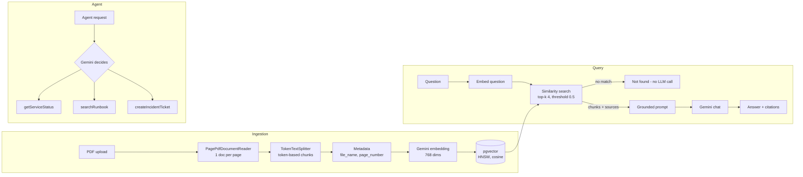

# LDAS Ops Copilot — RAG + Agent with Spring AI

An operations assistant for a lab-data platform. Upload runbook PDFs, ask questions in plain English,
and get answers **grounded in your documents with source citations**. An agent mode can also
**check service status, search runbooks and raise incident tickets** using LLM tool calling.

## Tech stack
- Java 21, Spring Boot 4, **Spring AI 2**
- **Google Gemini**: `gemini-3.5-flash-lite` (chat), `gemini-embedding-001` (768-dim embeddings)
- **PostgreSQL + pgvector** (HNSW index, cosine distance)
- Plain HTML/JS UI served by Spring Boot

## Architecture


## Features
- **Idempotent ingestion**: re-uploading a file replaces its chunks (delete by metadata filter, then insert)
- **Grounded answers with citations**: the system prompt restricts the model to the retrieved context; each chunk carries file + page
- **Hallucination guard**: if no chunk passes the similarity threshold, the API answers "not found" without calling the LLM
- **Agentic RAG**: `@Tool` methods let the model check live status, search runbooks and create tickets, chaining calls itself

## API
| Method | Endpoint | Purpose |
|---|---|---|
| POST | `/documents/upload` | Upload + ingest a PDF |
| GET | `/documents` | List documents and chunk counts |
| DELETE | `/documents/{fileName}` | Remove a document's chunks |
| GET | `/ask?q=` | RAG answer with sources |
| GET | `/agent?q=` | Agent answer (may call tools) |

## Run locally
```bash
docker run -d --name ragdb -e POSTGRES_USER=rag -e POSTGRES_PASSWORD=rag -e POSTGRES_DB=ragdb -p 5433:5432 pgvector/pgvector:pg16
export GEMINI_API_KEY=your-key      # PowerShell: $env:GEMINI_API_KEY="your-key"
./mvnw spring-boot:run
```
Open http://localhost:8080
